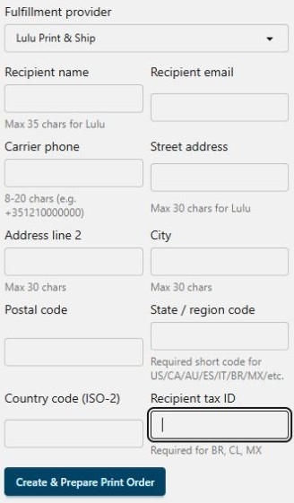
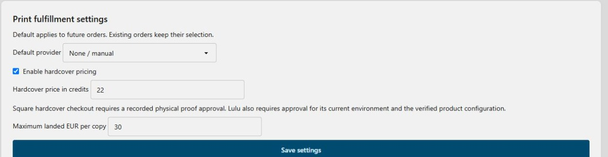
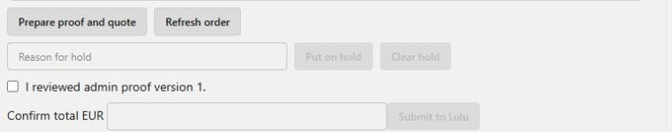

# Submit a physical book to Lulu from Mythoria Admin

**For the manager releasing a book to print.** Start in **Tickets** if a customer already ordered. Start in **Stories** if Mythoria is buying a copy for staff or arranging a new shipment. **The action that places the supplier order is on the fulfillment ticket.** Preparing files, receiving a quote, emailing a customer, and resolving a support ticket are separate events.

## 1. Find the right order

Sign in to the [Mythoria Admin portal](https://mythoria-admin-803421888801.europe-west9.run.app/) with an authorized staff account. For a customer order you also need access to the configured proof-reply inbox. For a supplier payment, cancellation investigation or claim, have the Lulu account owner available or use your authorized [Lulu Developer Portal](https://developers.lulu.com/) access.

| What brought you here?                                                 | Where to go and what to do                                                                                                                                                                                                                                                                                                                                                                                                                                                       |
| ---------------------------------------------------------------------- | -------------------------------------------------------------------------------------------------------------------------------------------------------------------------------------------------------------------------------------------------------------------------------------------------------------------------------------------------------------------------------------------------------------------------------------------------------------------------------- |
| A customer paid for printing                                           | Open **Tickets**, filter the type to **Print Request**, and **Open** the matching ticket. Match the order reference, story and purchaser. Open **Print fulfillment** and continue at step 4. The checkout has already recorded the order and shipping details. Creating a fresh order from the story can create a second shipment.                                                                                                                                               |
| You want a single physical proof of a published Premium Square edition | Open the story under **Stories → [story] → Premium Edition → Request one staff print proof**. Enter the **staff** delivery and contact details from step 3. Select **Create Proof Ticket → Open Staff Proof Ticket**. This path reopens the existing proof for the same story revision on a retry. It creates one square hardcover, starts with the manual provider, and costs the customer zero credits. Switch this ticket to Lulu in step 4. Public checkout can stay closed. |
| Mythoria is arranging a new shipment                                   | Open the published story. For standard books, expand **Order Print & Ship via Lulu**. For a published premium edition, expand **Dispatch Print Order via Lulu (1–10 copies)**. Complete steps 2 and 3. This creates a separate Admin order with zero customer credits.                                                                                                                                                                                                           |
| An older print ticket has no **Print fulfillment** panel               | On an open or in-progress print ticket with a linked story, expand **Upgrade & Dispatch via Lulu Fulfillment**. Complete steps 2 and 3 **on that ticket**. Check every prefilled value against the intended shipment. This preserves the existing ticket. If it already has a fulfillment panel, use that instead.                                                                                                                                                               |

Generating or downloading **Print PDFs**, where offered, gives you files. For a physical copy, use one of the four routes above. If a previous attempt timed out, search Tickets for the original request before starting another from the story. The general story form can create independent orders for the same title.

## 2. Choose the product for a new Admin order

| Field                     | What the manager chooses                                                                                                                                                                                                                                                                         |
| ------------------------- | ------------------------------------------------------------------------------------------------------------------------------------------------------------------------------------------------------------------------------------------------------------------------------------------------ |
| **Book format**           | **Standard A5** for a standard edition. Choose **Premium Square** for the published 8.5 × 8.5 inch edition. A standard story opens with A5 fixed. The premium form also offers A5, so check the format if you need the square artwork.                                                           |
| **Binding**               | Paperback or casewrap hardcover for A5, subject to supplier configuration. Premium Square uses hardcover.                                                                                                                                                                                        |
| **Order type and copies** | **Admin print & ship** allows 1–10 copies to one address. **Staff proof** limits quantity to one. For a repeatable premium proof request use the dedicated revision-based entry in step 1. An A5 staff proof created through the generic form can appear as **Admin print order** on the ticket. |
| **Fulfillment provider**  | Leave **Lulu Print & Ship** selected for this shipment. The generic story form defaults to Lulu and one copy. The global **None / manual** setting applies to the default for future orders. You can release an individual eligible ticket to Lulu with that default in place.                   |

## 3. Gather the delivery details once

The **story form starts blank**. On a legacy upgrade the name and email can come from the author or ticket contact. The address and phone may come from previously linked data. The author, person paying and parcel recipient can be three different people. Confirm who should actually receive the parcel. For a paid order, review the **Shipping address for this order** snapshot already on the ticket.

| Input                    | Required for Lulu? | What to provide                                                                                                                                                                                          |
| ------------------------ | ------------------ | -------------------------------------------------------------------------------------------------------------------------------------------------------------------------------------------------------- |
| **Recipient name**       | Yes                | Addressee on the parcel, up to 35 characters.                                                                                                                                                            |
| **Recipient email**      | Yes in Mythoria    | Delivery contact email. On paid orders, the digital proof goes to the purchaser's account email. Mythoria supplies its own configured supplier contact email to Lulu.                                    |
| **Carrier phone**        | Yes                | Reachable number for the parcel recipient. Use the international prefix where possible. The general form accepts 8–20 characters including permitted phone punctuation.                                  |
| **Street address**       | Yes                | Street and building number, up to 30 characters.                                                                                                                                                         |
| **Address line 2**       | When needed        | Apartment, floor, unit or additional delivery address, up to 30 characters.                                                                                                                              |
| **City**                 | Yes                | Delivery locality, up to 30 characters.                                                                                                                                                                  |
| **Postal code**          | Yes                | Delivery postcode in local format. The dedicated proof form can appear to allow an empty value, but Lulu preparation requires it.                                                                        |
| **Country code (ISO-2)** | Yes                | Two letters, such as `PT` for Portugal. The destination must be supported.                                                                                                                               |
| **State / region code**  | Depends on country | Use the short subdivision code where required, including US, CA, AU, ES, IT, BR and MX. For example, use `CA` for California with country `US`. Portugal has no mandatory subdivision in this validator. |
| **Recipient tax ID**     | For BR, CL and MX  | Obtain the actual recipient's required identifier through the approved contact channel and enter it in the designated field. A legacy ticket does not prefill it.                                        |

On the generic or legacy form select **Create & Prepare Print Order**, then **Open Print Fulfillment Ticket** or continue in the upgraded ticket. Admin creates or links the request first and attempts preparation immediately. If a ticket link and preparation warning appear together, open that ticket and address the warning there. On the dedicated premium proof form use **Create Proof Ticket** instead. No manager needs to upload PDFs, enter a Lulu product code, construct a storage link, or choose a shipping service.

## 4. Prepare this ticket for Lulu

1. Verify title, edition or revision, format, binding, copies and ship-to details. The ticket must be active to release it. Check for an existing supplier job before taking any create action.
2. Read **Provider**. If it is manual, select **Select Lulu** for A5 or **Prepare for Lulu** for Square. This changes the provider on this ticket. It can generate a new proof version because Lulu uses a different print profile.
3. If the current Lulu proof and quote are already ready, proceed to step 5. Otherwise wait for queued preparation or use **Prepare proof and quote** to run it immediately. The panel polls while preparing. A paid checkout queues work for the scheduled worker; a general Admin order already requested immediate preparation in step 3.
4. Expect **Interior proof**, **Cover proof**, QA, page count and a EUR supplier quote. For Square, also check the supplier validation and normalized page count. Lulu can count a 33-page source as 34 to size the cover. Compare the actual source pagination in the proof. The service uses the cheapest available traceable shipping service for the address. A missing quote, failed QA or blocked square eligibility needs attention before release.

**Provider settings are a setup task.** On 26 November 2026 the production **Tickets → Print fulfillment settings** card showed **None / manual**, hardcover pricing enabled at **22 credits**, and **Maximum landed EUR per copy** set to **30**. These are dated observations. Credits are a customer price and the EUR figure is a supplier spending ceiling per copy. Neither is the amount to enter at release. If setup blocks the ticket, ask the configuration owner to check credentials/environment, product, positive ceiling, supported destination and, for Square, staff-pilot or customer physical-proof approval for that environment and eligible customer countries. A working A5 job does not establish Square eligibility.

## 5. Review the files and customer reply

1. Open **Interior proof** and **Cover proof** for the numbered version on this ticket. Check title, author, language, pagination and blank pages, text and images near trim/gutter, and front, back and spine orientation. Match the binding and copy count to the intended order.
2. **Customer-paid order:** verify that this proof version shows **Emailed**, allow the team's review period, then search the configured reply inbox by order number for objections or corrections. Email acceptance records a send. It does not establish that the customer read or approved the book. The review period and inbox check are staff responsibilities today. If an objection is unresolved, enter the reason and choose **Put on hold**.
3. **Admin order or staff copy:** review the two PDFs on the ticket yourself. The dedicated premium form records the staff email as a contact. The fulfillment worker classifies staff proofs as Admin orders and skips its proof-email step for both. Check the box that matches the current proof version only after completing the review.
4. Review **Quote**, its shipping service, total for all copies, and EUR per copy. Check any available breakdown for print, shipping and tax. An illustrative one-copy production ticket showed **€16.76 total**. Use the current ticket amount every time.

## 6. Place the supplier order once

Enter the **whole quoted, tax-inclusive shipment total** in **Confirm total EUR**. For example, if two copies together cost €31.40, enter **31.40**. Then select the button shown for this order:

| Ticket               | Final button                     |
| -------------------- | -------------------------------- |
| Standard A5          | **Submit to Lulu**               |
| Premium Square order | **Release square order to Lulu** |
| Premium staff proof  | **Submit one proof to Lulu**     |

Mythoria rechecks the proof, current quote, shipping service, spending ceiling and submission state. A changed price or service requires a fresh review and confirmation. A successful create can incur a supplier charge against Mythoria's Lulu account, including when the customer charge is zero. Record the **Lulu job ID**, supplier status and environment shown on the ticket. A production job is the one relevant to a physical shipment. If the result is ambiguous, reconcile using step 7.

## 7. Follow the job through payment and shipping

| What you see                                           | What the manager does                                                                                                                                                                                                                                                                                                                                                                                              |
| ------------------------------------------------------ | ------------------------------------------------------------------------------------------------------------------------------------------------------------------------------------------------------------------------------------------------------------------------------------------------------------------------------------------------------------------------------------------------------------------ |
| **Submitting**, timeout or **uncertain**               | Keep the original ticket. Use **Refresh order**. Mythoria reconciles against the job or external order and line references. If unresolved, check those references in the Lulu Developer Portal and escalate ambiguous matches. A new story order could purchase a duplicate.                                                                                                                                       |
| **UNPAID** or **PAYMENT_IN_PROGRESS**                  | Open the matching job in the Lulu Developer Portal and verify payment or the account's automatic-payment arrangement. Mythoria customer credits and supplier payment have separate records. Production needs supplier payment. [Lulu payment methods](https://help.api.lulu.com/en/support/solutions/articles/64000254636-what-payment-methods-are-accepted-)                                                      |
| **PRODUCTION_DELAYED**                                 | Inspect the supplier job. Mythoria requests a 60-minute production delay when creating it. This post-payment buffer is separate from the customer's pre-submission review window. Account payment timing can add delay. [Lulu scheduled payments](https://help.api.lulu.com/en/support/solutions/articles/64000311553-how-do-i-set-up-scheduled-batch-payments-)                                                   |
| **PRODUCTION_READY**, **IN_PRODUCTION**, **SHIPPED**   | Use the latest supplier status. Once populated, open **Shipment link** or use the carrier and tracking ID. “Pending carrier assignment” can appear before tracking is issued. Webhooks and polling feed the ticket. Confirm any customer tracking communication through the team's support process.                                                                                                                |
| **REJECTED**, **CANCELED**, missing shipment or damage | Check the supplier record, record the outcome and advise the customer where applicable. Keep the job reference, dates, tracking and photos for a claim. Record a refund, replacement or supplier credit separately. Lulu specifies a 30-day window from shipment for the claims covered by its shipping FAQ. [Lulu shipping FAQ](https://help.api.lulu.com/en/support/solutions/articles/64000290027-shipping-faq) |

**Three statuses answer different questions.** The support ticket can remain **Open** after Mythoria shows **submitted** and Lulu shows **CANCELED**. This combination was visible on an existing production ticket. The job reached Lulu and was subsequently canceled. It is not awaiting initial release. Resolve the support ticket separately once the customer's outcome is accounted for. A recorded supplier cost, even on an unpaid or canceled job, is not evidence of settlement or a refund.

## If the order cannot proceed

| Symptom                                                                          | Recovery on the existing ticket                                                                                                                                                                                                                                                                                                                                                                                                                                                                                                                                                                         |
| -------------------------------------------------------------------------------- | ------------------------------------------------------------------------------------------------------------------------------------------------------------------------------------------------------------------------------------------------------------------------------------------------------------------------------------------------------------------------------------------------------------------------------------------------------------------------------------------------------------------------------------------------------------------------------------------------------- |
| Lulu flags the address                                                           | Contact the recipient or purchaser to confirm the deliverable address. On the held ticket edit the order shipping snapshot, check the confirmation box and use **Save customer-confirmed address**. A profile edit alone leaves the order snapshot intact. **Clear hold**, allow revised proof and quote generation, then repeat steps 5–6 with the new version. For a paid order this correction does not debit credits again. Lulu can return a suggested address during preflight. [Lulu address validation](https://help.api.lulu.com/en/support/solutions/articles/64000305072-address-validation) |
| Customer requests a content change                                               | Hold with a reason. For A5 use the correction and **Revise proof** flow. For an eligible paid Square order publish the correction first, then **Bind published correction** using its revision ID and a reason. It must be the current direct successor with the same page count. Binding retains the hold. Clear it when ready, recheck the revised PDFs, email and quote, and review the inbox again. Escalate revisions outside these criteria.                                                                                                                                                      |
| Missing email, bad PDF, no tracked service, cost over ceiling, or blocked market | Read the failure on the ticket. Resolve the specific delivery, file, address, product or approval issue with its owner. Resume preparation on the existing request. If using a manual printer instead, select that provider, prepare its own proof and follow the manual dispatch procedure. [Admin operations reference](../print-fulfillment.md)                                                                                                                                                                                                                                                      |
| A submitted job needs cancellation                                               | Where **Cancel Lulu job** is available, enter the required reason and request cancellation. Admin allows attempts in certain early supplier states. Lulu decides whether cancellation still succeeds. Refresh and confirm the actual supplier outcome. Payment/refund and a potential replacement each need separate follow-up. [Lulu API reference](https://lulu.apidocumentation.com/)                                                                                                                                                                                                                |

## Evidence and scope

Reviewed on 26 November 2026. The authenticated production walkthrough covered the ticket queue and settings, a published standard story's empty form, and existing submitted Admin and customer tickets. Images are cropped to omit customer details and signed proof links. Premium, legacy upgrade, editable holds, fresh release, payment and claims were traced against implementation and supplier documentation. The walkthrough created no order, submitted no payment and changed no settings. Production Square authorization for any specific destination, supplier account auto-pay, inbox contents, accessibility with assistive technology and physical delivery were outside the observation.

Implementation references: [Admin form](../../src/components/AdminLuluOrderForm.tsx), [ticket controls](../../src/components/PrintFulfillment.tsx), [premium story actions](../../src/app/stories/%5BstoryId%5D/components/PremiumStoryActions.tsx), [WebApp fulfillment](../../../mythoria-webapp/src/lib/print/fulfillment.ts), [supplier adapter](../../../mythoria-webapp/src/lib/lulu/client.ts), [staff orders](../../../mythoria-webapp/src/lib/print/staff-proof.ts), [customer checkout](../../../mythoria-webapp/src/lib/print/checkout.ts), [print renderer](../../../story-generation-workflow/src/services/order-proof.ts), and [proof email](../../../notification-engine/src/routes/email.ts). Cross-service links use the Mythoria workspace layout.

See [the manager experience review](../lulu-manager-experience.md) for proposed changes.
